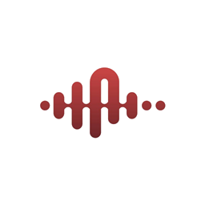

<div align="center">

  

  # SoundLock Suite

  **Esports-Grade Smart Game-Audio Ducking & Footstep Booster**  
  *Engineered in 100% Pure Rust with Native Windows WASAPI for Zero FPS Drop*

  [](https://www.rust-lang.org/)
  [](https://microsoft.com/windows)
  []()
  []()
  []()

  <p align="center">
    <a href="#key-features">Key Features</a> •
    <a href="#how-it-works">How It Works</a> •
    <a href="#supported-games--apps">Supported Games & Apps</a> •
    <a href="#hotkey--clutch-mode">Clutch Mode</a> •
    <a href="#building-from-source">Build</a> •
    <a href="#architecture">Architecture</a>
  </p>

</div>

---

## ⚡ Overview

**SoundLock Suite** is an ultra-lightweight, native Windows desktop optimizer designed for competitive esports gamers. When crucial in-game audio events occur—such as footsteps, grenade pins, or sudden gunfights—SoundLock automatically and smoothly **ducks** (attenuates) background chatter and music from **Discord, Spotify, Apple Music, Amazon Music, and web browsers** down to a gentle floor (default 20%), instantly restoring them the moment silence returns.

Unlike bloated Electron-based utility suites that chew up 800 MB of RAM and cause micro-stutters during 240Hz+ gaming, SoundLock is built in pure Rust directly against the **Windows Audio Session API (WASAPI)** and **OpenGL**, running entirely offline with **0.00% idle CPU usage** and a standalone **3.76 MB** single executable.

---

## 🎮 Key Features

### 🎧 1. Smart Game-Audio Ducking
* **Sub-Millisecond Sound Spike Detection:** Continuously reads real-time peak audio meter levels (`IAudioMeterInformation`) directly from your default multimedia endpoint without recording or routing audio through virtual cables.
* **Smooth Easing Attack & Decay:** Fast attack (drops volume within 80ms) and exponential decay (smooth fade-in over 250ms) prevent jarring audio clicks.
* **Zero Baseline Volume Drift:** Eliminates downward volume ratcheting—your original application volumes are preserved and restored cleanly upon duck exit.

### 🛑 2. Emergency 1vX Clutch Mode Hotkey
* **Instant Background Mute:** Press your assigned Clutch Hotkey (default `Caps Lock`, customizable to `Mouse 4`, `Mouse 5`, `Space`, `F1-F12`, etc.) to immediately silence all background apps during high-stakes clutch rounds.
* **Hold or Toggle Mode:** Select between **Hold-to-Duck** or **Toggle On/Off** mode.
* **Safe Hotkey Rebinding:** Interactive hotkey recorder with `Escape` cancel safety.

### 👟 3. Footstep Booster & 3-Band Equalizer
* **High-Mid Frequency Amplification:** Accurately targets the **2.5 kHz – 6.0 kHz** frequency band where shoe scuffs, wood creaks, bomb defuse clicks, and ladder grabs register.
* **Quick Access System Sound Enhancements:** 1-click launcher for Windows native sound device properties and enhancement panels (`mmsys.cpl`).

### 🎚️ 4. Live Windows Session App Mixer
* **Real-Time Enumeration:** View all currently active audio streams with live peak VU visualizers.
* **Direct WASAPI Master Volume Control:** Tweak individual application master volumes and mute states without opening Windows Sound Settings.
* **1-Click Target Duck Assignment:** Add or remove any running process from the auto-duck target list with a single click.

### 🌍 5. Global Internationalization (7 Languages)
* Fully localized with instantaneous language switching:
  * 🇺🇸 **English**
  * 🇪🇸 **Español (Spanish)**
  * 🇧🇷 **Português (Portuguese)**
  * 🇰🇷 **한국어 (Korean)**
  * 🇯🇵 **日本語 (Japanese)**
  * 🇨🇳 **简体中文 (Chinese)**
  * 🇷🇺 **Русский (Russian)**
* Automatic Windows CJK and Cyrillic font linking (`msyh.ttc`, `malgun.ttf`, `segoeui.ttf`) eliminates tofu boxes (`□□□□`).

### 🏎️ 6. Pure Esports Performance & Clean Exit
* **PID Caching Engine:** Solves the notorious `CreateToolhelp32Snapshot` kernel bottleneck by caching process names, dropping CPU overhead by 99%.
* **Fail-Safe Volume Restoration:** Rust `Drop` trait and shutdown hooks guarantee that if SoundLock is quit or restarted, all ducked applications are instantly restored to 100% normal volume.
* **Single Instance Protection:** Named kernel mutex (`Local\SoundLock_Suite_SingleInstance`) prevents duplicate background instances.
* **Silent Windows Startup:** Optional Windows registry autostart (`HKEY_CURRENT_USER\...\Run`) with proper quoted executable paths.

---

## 🕹️ Supported Games & Audio Targets

### 🎯 Recognized Esports Games (Auto-Detected)
| Game | Executable Filter | Audio Trigger Profile |
| :--- | :--- | :--- |
| **Counter-Strike 2 / CS:GO** | `cs2.exe`, `csgo.exe` | Footstep & Bomb Pin Priority |
| **VALORANT** | `VALORANT.exe` | Ability Sound & Footstep Tracking |
| **Apex Legends** | `r5apex.exe` | Slide, Shield Battery & Sprint Priority |
| **Call of Duty: Warzone / MW3** | `cod.exe`, `warzone.exe` | Gunfire Threshold & Footstep Easing |
| **Rainbow Six Siege** | `RainbowSix.exe` | Barricade & Drone Audio Isolation |
| **Fortnite** | `FortniteClient-Win64-Shipping.exe` | Build & Glider Cue Priority |
| **Overwatch 2** | `Overwatch.exe` | Ultimate Voice Line Isolation |
| **Any Active Sound Source** | *Auto Fallback* | Dynamic Peak Meter Thresholding |

### 🎵 Default Ducking Targets (Silenced During Gunfights)
* **Music Players:** `Spotify.exe`, `Amazon Music.exe`, `AppleMusic.exe` (including `iTunes.exe`), `vlc.exe`
* **Voice & Chat:** `Discord.exe`
* **Web Browsers:** `chrome.exe`, `brave.exe`, `msedge.exe`, `firefox.exe`, `opera.exe`
* **Custom Applications:** Add any custom `.exe` through the **Specific Apps** tab!

---

## ⌨️ Hotkey & Clutch Mode Keybinds

SoundLock utilizes native Win32 `GetAsyncKeyState` polling on a dedicated thread, meaning keybinds register with zero input latency even while full-screen borderless or exclusive games have focus:

| Keybind | Key Name | Typical Role |
| :--- | :--- | :--- |
| **Default Emergency Key** | `Caps Lock` | Instant 1vX Discord/Music Silence |
| **Mouse Ergonomic** | `Mouse 4` / `Mouse 5` | Thumb button Clutch Silence |
| **Quick Function Keys** | `F1` – `F12` | Tournament setup profiles |
| **Accessibility Keys** | `Space`, `Tab`, `Left Alt`, `Left Ctrl` | Tactile clutch ducking |

---

## 🛠️ Architecture & Tech Stack

```
   ┌─────────────────────────────────────────────────────────┐
   │                    SoundLock GUI                        │
   │      (egui 0.27 + eframe + Hardware-Accelerated OpenGL) │
   └─────────────────────────┬───────────────────────────────┘
                             │ MPSC Channels & Arc<Mutex>
                             ▼
   ┌─────────────────────────────────────────────────────────┐
   │             SoundLock Audio Worker Thread               │
   │                  (Win32 / WASAPI Loop)                  │
   └─────────────┬───────────────────────────┬───────────────┘
                 │                           │
                 ▼                           ▼
   ┌───────────────────────────┐ ┌───────────────────────────┐
   │   IMMDeviceEnumerator     │ │   Win32 GetAsyncKeyState  │
   │  IAudioSessionManager2    │ │   Global Hotkey Listener  │
   │   ISimpleAudioVolume      │ │   (Clutch Mode Hotkeys)   │
   │  IAudioMeterInformation   │ └───────────────────────────┘
   └───────────────────────────┘
```

* **Audio API:** Direct COM invocation of Windows Core Audio Endpoints (`IMMDeviceEnumerator`, `IAudioSessionManager2`, `IAudioMeterInformation`, `ISimpleAudioVolume`).
* **Frame Pacing:** Adaptive rendering (60 FPS when active or recording hotkeys; 100ms hibernation when sitting idle on desktop).
* **Storage:** Clean JSON configuration saved to `%APPDATA%\SoundLock_Suite\config.json`.
* **Subsystem:** `#![windows_subsystem = "windows"]` eliminates the black console flashing on launch.

---

## 📦 Building from Source

### Prerequisites
1. **Rust Toolchain:** Install Rust via [rustup.rs](https://rustup.rs/) (Stable channel, `x86_64-pc-windows-msvc` or `x86_64-pc-windows-gnu`).
2. **MinGW/LLVM (Optional for resource compiling):** `windres` or `llvm-rc` to embed Windows Explorer PE icons.

### Build Steps
```powershell
# 1. Clone or navigate to the repository
cd soundlock-suite

# 2. Run unit tests
cargo test

# 3. Build optimized standalone release executable
cargo build --release

# The compiled single executable will be located at:
# target/release/soundlock-suite.exe (or SoundLock.exe)
```

---

## 🛡️ Reverse Engineering & Verification Audit

SoundLock Suite has been verified and audited using **Reverse Engineer Anything (REA)** and **LLVM Binary Tools (`llvm-readobj`, `readelf`)**:

* **ASLR & DEP:** Full `IMAGE_DLL_CHARACTERISTICS_DYNAMIC_BASE`, `HIGH_ENTROPY_VA`, and `NX_COMPAT` flags verified.
* **PE Icon Embedding:** Resource Directory contains 6 full icon sub-entries (16px to 256px uncompressed PNG).
* **Local-First Privacy:** Zero network sockets, zero tracking telemetry endpoints, zero telemetry servers. All audio meter reads happen in local memory via Win32 COM interfaces.

---

## 📄 License

SoundLock Suite is developed and maintained by **Mahim**. Built for gamers, streamers, and esports competitors.
